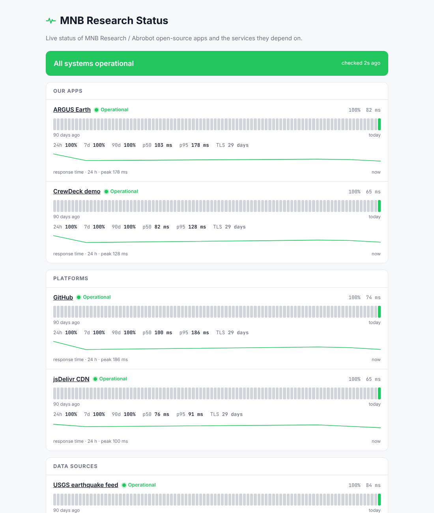

<div align="center">

# 📈 PulseBoard

### A free, serverless uptime monitor and status page. No server, no database, no dependencies.

GitHub Actions checks your sites every 5 minutes, commits the history to the repo and publishes a fast status page on GitHub Pages. You get 90-day uptime bars, latency charts, TLS-expiry warnings, auto-incidents, badges, RSS and alerts to Discord, Slack, Telegram, ntfy or any webhook.

**[▶ Live status page](https://mnbresearch.github.io/pulseboard/)** · [Set up in 3 minutes](#-set-up-in-3-minutes) · [Monitors](#-monitor-options) · [Alerts](#-alerts) · [Use cases](#-use-cases)

[](https://mnbresearch.github.io/pulseboard/)



</div>

---

## Why PulseBoard?

[Uptime Kuma](https://github.com/louislam/uptime-kuma) is a great self-hosted monitor, but it needs a server that is up even when your site is down. PulseBoard runs on infrastructure you already have for free: **GitHub Actions + GitHub Pages**. It's an independent, from-scratch project inspired by Uptime Kuma (MIT); no code was copied.

| | |
|---|---|
| ⏱ **Checks every 5 min** | HTTP(S) status, keyword present / absent, max response time, TCP ports |
| 🧪 **No false alarms** | Automatic quick retry, and incidents only open after **2 consecutive failures** |
| 🚨 **Auto-incidents** | Opened, updated and resolved automatically with a timeline and duration |
| 🔐 **TLS expiry** | Days until certificate expiry; alert when ≤ 14 days, degraded when ≤ 3 |
| 📊 **Rich page** | 90-day uptime bars, 24 h / 7 d / 30 d / 90 d uptime, p50 / p95 latency, 24 h response-time sparkline, groups, dark mode, mobile |
| 🔔 **Alerts** | Discord, Slack, Telegram, ntfy.sh, generic webhook — set a secret and it works |
| 🏷 **Badges** | SVG badges per monitor and overall, for READMEs and docs |
| 📡 **Feeds** | RSS for incidents, JSON API (`data/status.json`) |
| 🧰 **Also local** | `node check.mjs --serve 8080` runs the same thing on any machine |
| 🪶 **Tiny** | ~600 lines, zero dependencies, readable in one sitting |

## 🚀 Set up in 3 minutes

1. **Use this repo** — click **Fork** (or *Use this template*).
2. **Edit [`pulseboard.config.json`](pulseboard.config.json)** — your title, page URL and monitors.
3. **Settings → Pages → Source: _GitHub Actions_.**
4. **Actions tab → enable workflows → run "Monitor" once.** Your page is live at `https://<you>.github.io/pulseboard/` and updates every 5 minutes.

Optional: add alert secrets (below) under **Settings → Secrets and variables → Actions**.

> GitHub may delay scheduled workflows by a few minutes at busy times, and pauses schedules in repos with no activity for 60 days (the history commits count as activity).

## ⚙️ Monitor options

```jsonc
{
  "id": "api",                 // unique, used for file names and badges
  "name": "Public API",
  "group": "Backend",          // groups on the page
  "url": "https://api.example.com/health",
  "method": "GET",             // any HTTP method; "body" and "headers" supported
  "expectStatus": [200, 204],  // default: any 2xx/3xx
  "keyword": "\"ok\":true",    // must appear in the body
  "notKeyword": "maintenance", // must NOT appear
  "maxMs": 3000,               // slower than this = failure
  "degradedMs": 1200,          // slower than this = degraded (yellow)
  "timeoutMs": 10000,
  "certWarnDays": 14,
  "public": true               // false hides the URL on the page
}
```

TCP checks: `{ "id": "db", "name": "Postgres", "type": "tcp", "host": "db.example.com", "port": 5432 }`.

## 🔔 Alerts

Add any of these as repository secrets; alerts fire when an incident opens, resolves, or a certificate is close to expiry.

| Secret | Channel |
|---|---|
| `DISCORD_WEBHOOK_URL` | Discord channel webhook |
| `SLACK_WEBHOOK_URL` | Slack incoming webhook |
| `TELEGRAM_BOT_TOKEN` + `TELEGRAM_CHAT_ID` | Telegram bot |
| `NTFY_TOPIC` | Push to phone via [ntfy.sh](https://ntfy.sh) |
| `ALERT_WEBHOOK_URL` | Generic JSON `{event, monitor, name, text, incident, statusPage}` |

## 🧭 Use cases

- **Indie hackers & startups** — a public status page and README badges for your SaaS on day one, for $0.
- **Open-source maintainers** — monitor docs sites, demo deployments, package registries and APIs your project depends on (like this repo does for [ARGUS Earth](https://github.com/mnbresearch/argus-earth) and [CrewDeck](https://github.com/mnbresearch/crewdeck)).
- **Agencies** — one fork per client with their branding; send the link instead of answering "is it down?" emails.
- **Internal teams** — watch third-party dependencies (payment provider, auth, CDN) and get a Slack ping before customers notice.
- **Students & homelabs** — monitor your home server's public endpoints and get ntfy pushes on your phone.
- **SLA reporting** — 90-day uptime per service from `data/history/*.json`, ready for monthly reports.

## 🧱 How it works

```
pulseboard.config.json      what to monitor
check.mjs                   probes → data/history/<id>.json, status.json, incidents.json, badges/, feed.xml → alerts
lib/core.mjs                pure logic: history rollups, uptime, percentiles, incidents, badges, RSS (unit-tested)
index.html, status.js       static status page that reads ./data
.github/workflows/monitor.yml   every 5 min: check → commit history → deploy Pages
```

History keeps raw checks for 7 days and daily rollups for 90 days, so the repo stays small (~a few MB per monitor per year).

## 🖥 Run locally / self-host

```bash
git clone https://github.com/mnbresearch/pulseboard.git && cd pulseboard
node check.mjs                # one round of checks
node check.mjs --serve 8080   # checks every 60 s + status page on http://127.0.0.1:8080
npm test
```

## License

[MIT](LICENSE) © 2026 Mridul Nanda — [MNB Research](https://github.com/mnbresearch) · Abrobot.ai
